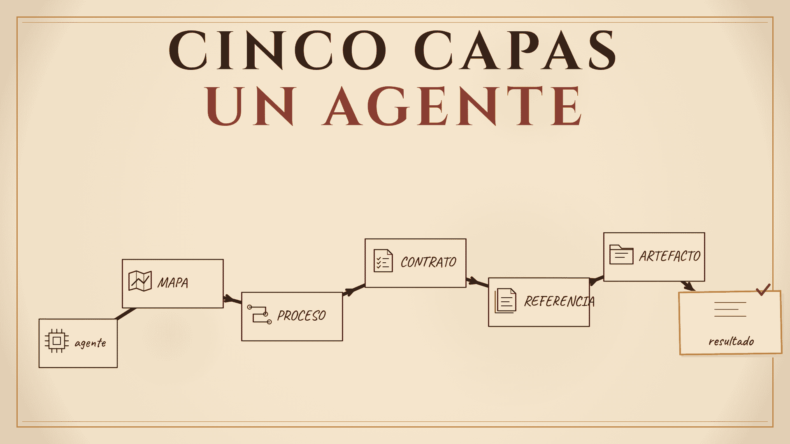

<!-- Production: image at `src/assets/blog/como-funciona-el-repositorio.png` (migrated from Sirv on 2026-10-30) — the video's thumbnail `content-writing/animations/videos/como-funciona-el-repositorio/06_render/thumbnails/thumb.es.png`. -->

# How the repository works: five layers and an agent that knows where it stands

My repository is not a way to store folders. It is a representation of how I work: my process, my criteria, and what a good job means to me.

In [the previous post](/en/blog/the-loop-i-couldnt-see), I wrote about why I wrote my process down. This one is about how I turned it into something an agent can operate. The full video (in Spanish) is here: [Cómo cree mi espacio de trabajo optimizado para agentes](https://youtu.be/2SuxeTkB84c).

## Three things are missing

A program needs three things: instructions, a machine to run them, and a result.

The instructions are my working process. The machine is an AI agent. The result is what each stage produces.

Writing it down is the difference. What I used to improvise was not my work. It was an idea of my work. Once the process is written, with my opinions, my criteria, my context and my nuances, the machine can follow it without guessing.

## The shape: ICM

To give those instructions to the agent I use **Interpretable Context Methodology**, or **ICM**, created by **Jake Van Clief**. I learned it in **Clief Notes**, the community where I started to understand this approach.

ICM is a guide for turning your instructions into folders and files that a person or an agent can follow. It does not replace your judgment. It puts that judgment somewhere you can read, review and improve.

## The five layers

### 1. The map

`AGENTS.md` is the map. It is the first file read, even when the workspace is opened by an agent.

It should say where you are, what this workspace is, what is inside, where each task goes and which rules apply.

### 2. The stage table

`CONTEXT.md` is the stage table. It is the workspace's top-level reference: the process from end to end.

Depending on the stage your task is in, it tells you where to go.

### 3. The stages and their contracts

Every stage has a contract. The contract is the instruction, and it defines four things:

- the data it works with,
- the process it must follow,
- the result it must create,
- what a good job looks like.

It also defines what must be completed before the stage is done and who reviews it.

This is where the system becomes personal. The contract is not only a procedure. It is the place where your criteria are written down.

### 4. Reference material

Criteria, standards, previous successful results and the knowledge shared by the stages live in one place.

One home for each fact. That way there are never two versions of the truth.

### 5. Artifacts

The artifact is the unit of work. It enters as the first stage's input and is transformed stage by stage until it becomes the result.

It has its own data and its own rules, and it changes from one case to the next.

## A real example: from contact to case study

My client workspace has six stages: contact, diagnosis, proposal, close, build and case study.

When the agent gets a task, it navigates the structure to find where it should go.

To create a client's case study, it first reads `AGENTS.md`. The map gives it context and tells it to read `CONTEXT.md`. There it finds the case-study stage and learns what is expected from it.

Then it opens the stage contract. That contract explains the instructions for completing the stage.

With that, it enters the artifact: the client folder. It reads the contact record, what was agreed at closing, and the metrics measured before building. With the reference rules at hand, it writes the case study in its folder.

When it finishes, I read the result. If something needs improving, I make the correction. If not, I approve the result and the stage closes.

Every stage produces a result that feeds later stages. The diagnosis is needed to generate the proposal. The build needs the scope and requirements. The case study needs the diagnosis metrics and the product metrics.

Chained together, the results of each stage become the result of the whole workspace.

## What changes when it is written

Before, I depended on my memory and on having a good week.

Now the process can survive a bad week, a vacation and a new person joining. An agent can operate it. And my worst day can no longer quietly lower the standard.

This does not mean the structure is rigid. ICM is not a fixed structure. It is a flexible guide you can adjust to your case once you understand the fundamentals.

What is not written cannot be delegated. It cannot be improved either.

## Conclusion

Five layers let an agent know where it is standing: the map, the table, the contracts, the reference material and the artifacts.

If an agent, or a person, worked with your process tomorrow, what part would it have to guess?

If you made it this far, thank you for reading. If any of this sounds like your own system, write to me. I want to know which part of your work still lives only in your head.
