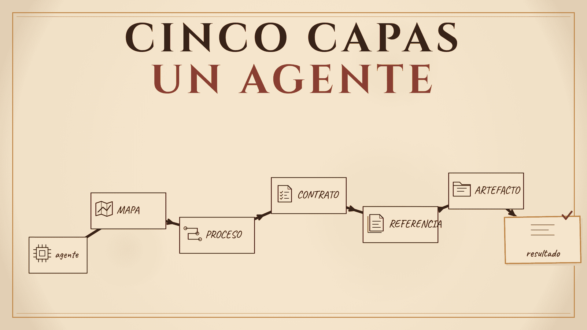

<!-- Producción: imagen en `src/assets/blog/como-funciona-el-repositorio.png` (migrada de Sirv el 2026-10-30) — thumbnail del video `content-writing/animations/videos/como-funciona-el-repositorio/06_render/thumbnails/thumb.es.png`. -->

# Así funciona el repositorio: cinco capas y un agente que sabe dónde está parado

Mi repositorio no es una forma de guardar carpetas. Es una representación de cómo trabajo: mi proceso, mis criterios y cómo se ve para mí un trabajo bien hecho.

En [el post anterior](/es/blog/el-loop-que-no-veia) te conté por qué escribí mi proceso. En este te enseño cómo lo convertí en algo que un agente puede operar. El video completo está acá: [Cómo cree mi espacio de trabajo optimizado para agentes](https://youtu.be/2SuxeTkB84c).

## Tres cosas hacen falta

Un programa necesita tres cosas: instrucciones, una máquina que las ejecute y un resultado.

Las instrucciones son mi proceso de trabajo. La máquina es un agente de IA. El resultado es lo que produce cada etapa.

La diferencia está en escribirlo. Lo que improvisaba no era mi trabajo: era una idea de mi trabajo. Cuando el proceso queda escrito, con mis opiniones, mi criterio, mi contexto y mis matices, la máquina puede seguirlo sin adivinar.

## La forma: ICM

Para darle esas instrucciones al agente uso **Interpretable Context Methodology**, o **ICM**, creada por **Jake Van Clief**. La aprendí en **Clief Notes**, la comunidad donde empecé a entender este enfoque.

ICM es una guía para plasmar tus instrucciones en carpetas y archivos de una manera que una persona o un agente pueda seguir. No reemplaza tu criterio. Lo pone en un lugar donde se puede leer, revisar y mejorar.

## Las cinco capas

### 1. El mapa

El archivo `AGENTS.md` es el mapa. Es lo primero que se lee, incluso si quien abre el workspace es un agente.

Debe decir dónde estás, qué es este workspace, qué tiene adentro, a dónde va cada tarea y qué reglas aplican.

### 2. La tabla de etapas

`CONTEXT.md` es la tabla de etapas. Es la referencia superior del workspace: el proceso de punta a punta.

Según la etapa en la que esté tu tarea, te dice a dónde ir.

### 3. Las etapas y sus contratos

Cada etapa tiene su contrato. El contrato es la instrucción y define cuatro cosas:

- los datos con los que trabaja,
- el proceso que debe hacer,
- el resultado que debe crear,
- cómo se ve un trabajo bien hecho.

También define qué hay que cumplir para marcar la etapa como completada y quién la revisa.

Aquí vive lo más personal del sistema. El contrato no es solo un procedimiento. Es el lugar donde quedan escritos tus criterios.

### 4. El material de referencia

Los criterios, los estándares, los resultados exitosos anteriores y el conocimiento que comparten las etapas viven en un solo lugar.

Una sola casa por dato. Así nunca hay dos versiones de la verdad.

### 5. Los artefactos

El artefacto es la unidad de trabajo. Entra como input de la primera etapa y se transforma etapa por etapa hasta convertirse en el resultado.

Tiene sus propios datos y sus propias reglas, y cambia de un caso al siguiente.

## Un ejemplo real: del contacto al caso de estudio

Mi espacio de trabajo para clientes tiene seis etapas: contacto, diagnóstico, propuesta, cerrar, desarrollar y caso de estudio.

Cuando el agente recibe una tarea, navega la estructura para encontrar dónde debe ir.

Para crear el caso de estudio de un cliente, primero lee `AGENTS.md`. El mapa le da contexto y le pide leer `CONTEXT.md`. Ahí encuentra la etapa de caso de estudio y aprende qué se espera de ella.

Después abre el contrato de la etapa. Ese contrato explica las instrucciones para cumplirla.

Con eso entra al artefacto: la carpeta del cliente. Lee la ficha del contacto, lo que se acordó en el cierre y las métricas que se midieron antes de construir. Con las reglas de referencia a la mano, escribe el caso de estudio en su carpeta.

Cuando termina, leo el resultado. Si hay algo que mejorar, hago la corrección. Si no, apruebo el resultado y la etapa se cierra.

Cada etapa produce un resultado que alimenta las etapas siguientes. El diagnóstico sirve para generar la propuesta. El desarrollo necesita el alcance y los requisitos. El caso de estudio necesita las métricas del diagnóstico y las del producto.

Encadenados, los resultados de cada etapa se convierten en el resultado del workspace entero.

## Qué cambia cuando está escrito

Antes dependía de mi memoria y de que tuviera una buena semana.

Ahora el proceso puede sobrevivir a una mala semana, a unas vacaciones y a que entre alguien nuevo. Un agente puede operarlo. Y mi peor día ya no puede bajar el estándar en silencio.

Esto no significa que la estructura sea rígida. ICM no es una estructura fija: es una guía flexible que puedes ajustar a tu caso una vez que entiendes los fundamentos.

Lo que no está escrito no se puede delegar. Tampoco se puede mejorar.

## Conclusión

Cinco capas hacen que un agente sepa dónde está parado: el mapa, la tabla, los contratos, la referencia y los artefactos.

Si mañana un agente, o una persona, trabajara con tu proceso, ¿qué parte tendría que adivinar?

Si llegaste hasta aquí, gracias por leerme. Si algo de esto suena a tu propio sistema, escríbeme: me interesa saber qué parte de tu trabajo todavía vive solo en tu cabeza.
